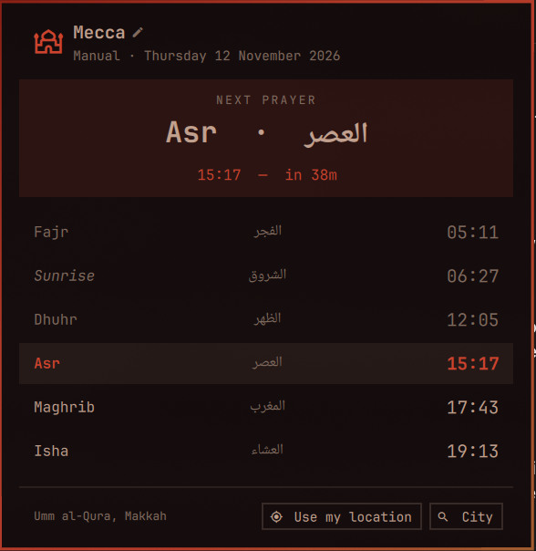

# Prayer Times for Omarchy

A mosque icon in the [Omarchy](https://omarchy.org) bar. Click it to see today's Islamic prayer times, with the next prayer and a live countdown.



## Features

- **Today's times:** Fajr, Sunrise, Dhuhr, Asr, Maghrib and Isha, in English and Arabic. The next prayer is highlighted and past ones are dimmed.
- **Automatic location:** uses GeoClue (GPS / Wi-Fi) when it's available, otherwise a network-based city lookup. Location is re-checked every 30 minutes.
- **Manual city:** click the city name and search for any city in the world. Times are shown in that city's local time.
- **Works offline:** times are calculated on your machine, with no prayer-times API.
- **Official conventions:** `Auto` picks the method for the location's country (Morocco, Algeria, Tunisia, Egypt, Umm al-Qura, Gulf, Diyanet, Karachi, Tehran, ISNA, UOIF, MUIS/JAKIM, or MWL elsewhere).
- **Notifications** at each prayer time.
- Follows your Omarchy theme.

## Install

```bash
omarchy plugin add https://github.com/OWNER/omarchy-prayer-times.git --enable
```

When asked where to put it, `centerBegin` places it just left of the clock.

Update later with:

```bash
omarchy plugin update prayer-times
```

Remove it with:

```bash
omarchy plugin remove prayer-times
```

Requires `curl` and `jq`, both of which ship with Omarchy.

## Usage

| Action | Result |
|---|---|
| Left click | Open or close today's prayer times |
| Middle click | Re-detect your location |
| Click the city name / **City** | Search for and pick a city |
| **Use my location** | Go back to automatic location |

## Settings

Change settings from the bar's widget settings, or from the command line:

```bash
omarchy bar set prayer-times method Morocco
omarchy bar set prayer-times asr Hanafi
omarchy bar set prayer-times timeFormat 12h
omarchy bar set prayer-times showNextPrayer true --json
omarchy bar set prayer-times notify false --json
omarchy bar set prayer-times fajrOffset 2 --json
```

| Key | Values | Default |
|---|---|---|
| `method` | `Auto`, `MWL`, `ISNA`, `Egypt`, `Makkah`, `Karachi`, `Tehran`, `Morocco`, `Algeria`, `Tunisia`, `Gulf`, `Turkey`, `France`, `Singapore` | `Auto` |
| `asr` | `Standard`, `Hanafi` | `Standard` |
| `timeFormat` | `24h`, `12h` | `24h` |
| `showNextPrayer` | show the next prayer beside the icon | `false` |
| `notify` | notification at each prayer time | `true` |
| `fajrOffset`, `dhuhrOffset`, `asrOffset`, `maghribOffset`, `ishaOffset` | minutes, -30 to 30 | `0` |

If a time differs from your local mosque by a minute or two, use the offset settings.

## Command line

```bash
omarchy-shell prayer-times toggle
omarchy-shell prayer-times next
omarchy-shell prayer-times edit
omarchy-shell prayer-times relocate
```

`next` prints the next prayer, its time, and the countdown.

## Location and privacy

- The network lookup asks `geo.omarchy.org`, the service Omarchy's weather widget uses.
- City search uses the [Open-Meteo geocoding API](https://open-meteo.com/en/docs/geocoding-api).
- Your chosen city is stored locally in `~/.local/state/prayer-times/location.json`. Nothing else is sent anywhere.

For more precise positioning on a laptop without GPS, install GeoClue and run an authorization agent:

```bash
omarchy pkg add geoclue
```

```bash
/usr/lib/geoclue-2.0/demos/agent &
```

The plugin only uses GeoClue's position when it is accurate to within 5 km. Wi-Fi positioning depends on [BeaconDB](https://beacondb.net) coverage in your area.

## License

MIT
